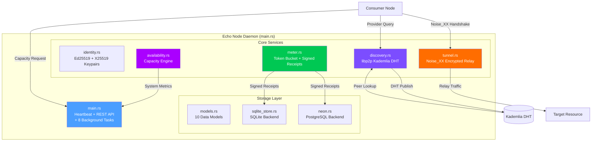
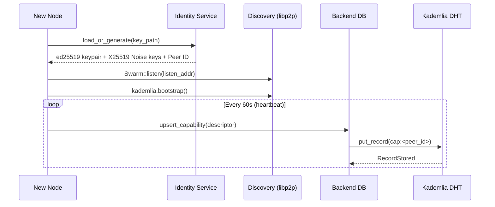
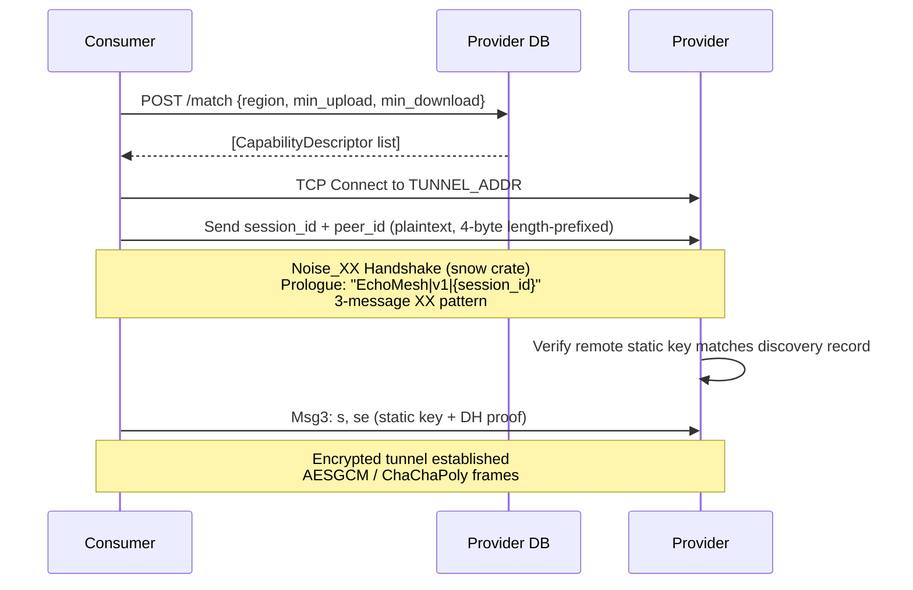
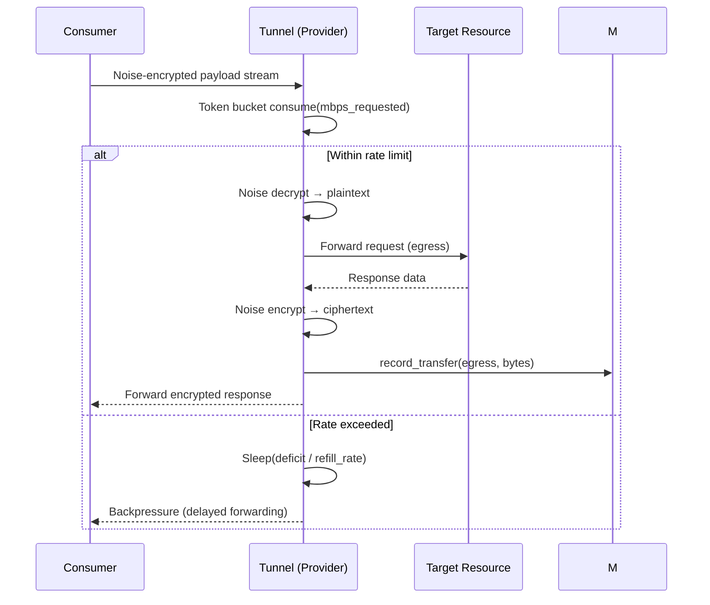
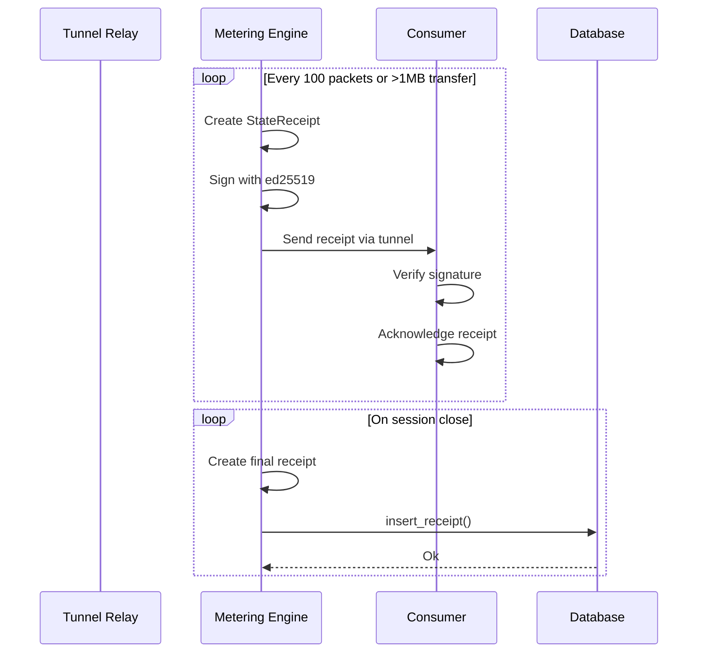
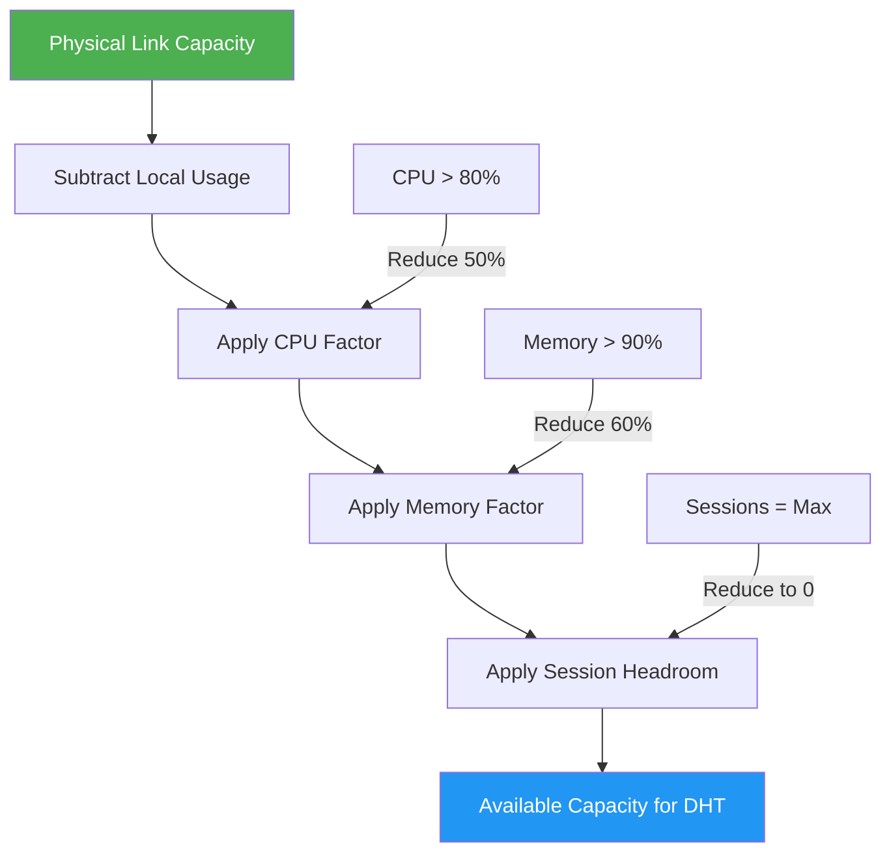
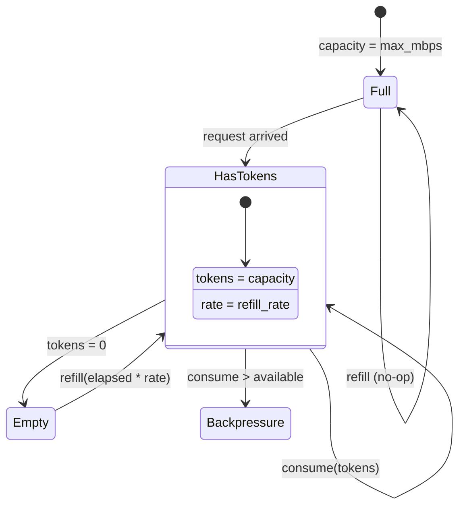
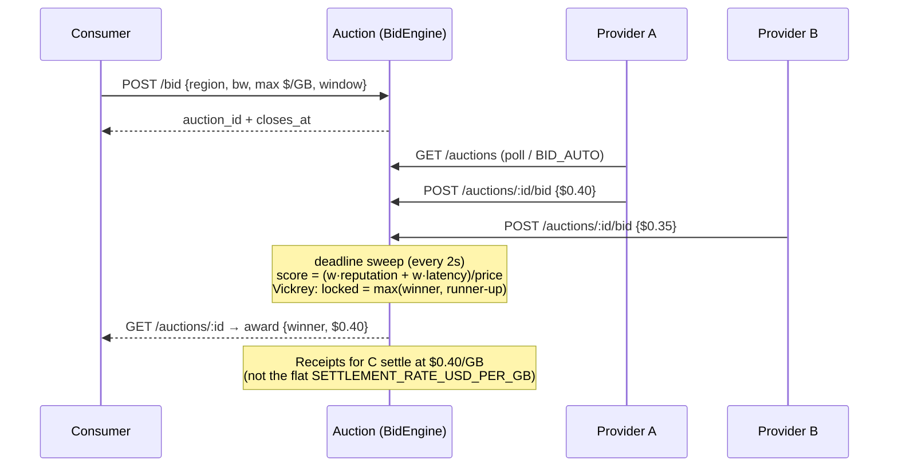

# Echo Node

Rust daemon for the EchoMesh decentralized infrastructure network. A node that either shares unused network capacity as a **provider** (Noise_XX-encrypted tunnels, discovered via a Kademlia DHT) or runs as a **consumer** that dials a provider and forwards local application traffic through the tunnel.

## Architecture Overview



## Step-by-Step Flow

### 1. Registration & Peer Discovery



### 2. Matchmaking & Noise_XX Handshake



### 3. Data Tunneling & Rate Limiting



### 4. Metering & Receipt Settlement



## Security Model

| Layer | Mechanism | Detail |
|-------|-----------|--------|
| **Tunnel encryption** | Noise_XX_25519_ChaChaPoly_BLAKE2s | 3-message XX pattern via `snow` crate |
| **Session binding** | Domain-separated prologue | `"EchoMesh\|v1\|{session_id}"` prevents cross-session replay |
| **MITM prevention** | Static key pinning | Provider's Noise public key verified against DB capability record |
| **Connection limiting** | Semaphore with RAII permits | `OwnedSemaphorePermit` in `EncryptedTunnelSession` |
| **Identity protection** | File permissions 0600 | Unix `set_permissions` on identity file after every write |
| **Identity crash-safety** | Atomic writes + corrupt recovery | temp file → fsync → rename (a kill mid-write never truncates keys); unreadable files preserved as `*.corrupt-<ts>` and regenerated |
| **API authentication** | Scoped constant-time Bearer tokens | `API_KEYS` (per-key `control`/`settlements` scopes) or legacy `API_KEY` (admin); XOR-based comparison prevents timing side-channels; 401/403 |
| **Admission policy** | Optional reputation/latency gates + quotas | `POLICY_*` env; RAII permits release slots on drop; all-open by default (engine off hot path) |
| **Trust decay** | Idle-time reputation half-life | `REPUTATION_DECAY_HALF_LIFE_DAYS` (default 30) — the min-reputation gate scores `raw · 0.5^(idle/half_life)` so stale trust erodes |
| **Slowloris guard** | Handshake deadline | `TUNNEL_HANDSHAKE_TIMEOUT_MS` (default 10 s) bounds the preamble + every Noise handshake read, and the consumer's dial |
| **Match filtering** | `/match` hygiene | rejects malformed requests (region caps, sane bandwidth floors), drops self/blocked/full/stale/keyless providers (`MATCH_MAX_STALE_SECS`) |
| **Body limits** | 16 KiB request cap | all HTTP request bodies capped (control-plane JSON is tiny) |
| **Security alerts** | Sliding-window burst detector | ≥ `SECURITY_ALERT_THRESHOLD` events in `SECURITY_ALERT_WINDOW_SECS` → `error!` log + `alert_active` in `/status`/`/health` + event ring in `GET /security` |
| **Soft-slashing** | Composite accountability gate | `POLICY_MIN_ACCOUNTABILITY` scores peers as *trust-decayed reputation × per-peer security-violation discount × session availability*; judgment-based denials attribute new violations. No stake locked — deferred until a market exists |
| **DHT namespacing** | Network-id prefixed Kademlia protocol | `DHT_NETWORK_ID` isolates swarms (`/<id>/kad/1.0.0`); bootstrap + local-only via `DHT_*` |
| **Input validation** | Length caps on pre-handshake messages | session_id <= 256 bytes, peer_id <= 512 bytes |
| **Receipt integrity** | Ed25519 signatures | Provider signs receipts; consumers verify |
| **Canonical ledger** | Append-only hash-chained events | Every market/settlement/reputation/security/tunnel action emits a `LedgerEvent`; `sha256:<hex>` chain per node, ed25519-signed, `ECHO_NETWORK` separates networks |

## Capacity Engine

The Availability Engine dynamically adjusts advertised bandwidth based on system load:



## Token Bucket Rate Limiter



## Database Schema

```mermaid
erDiagram
    NODES {
        varchar id PK
        varchar name NOT_NULL
        varchar user_id NOT_NULL
        varchar peer_id UK
        text public_key
        text ip_address
        text region
        varchar status NOT_NULL DEFAULT_offline
        text last_seen_at
        double precision uptime NOT_NULL DEFAULT_0
        double precision latency NOT_NULL DEFAULT_0
        double precision bandwidth_used NOT_NULL DEFAULT_0
        double precision quality_score NOT_NULL DEFAULT_0
        double precision earnings NOT_NULL DEFAULT_0
        double precision packet_loss NOT_NULL DEFAULT_0
        double precision uptime_pct
        double precision avg_latency_ms
        double precision bandwidth_down_mbps
        double precision bandwidth_up_mbps
        double precision packet_loss_pct
        double precision trust_score
        bigint sessions_count
        double precision earnings_usd
        double precision reported_upload_cap_mbps
        double precision reported_download_cap_mbps
        varchar supported_encryption
        jsonb services NOT_NULL DEFAULT_'{}'
        jsonb metadata
        timestamptz last_updated
        text last_ip
        text created_at
        text updated_at
    }

    PEER_REPUTATION {
        text peer_id PK
        double precision reputation_score
        bigint total_bytes_relayed
        bigint successful_sessions
        bigint failed_sessions
        double precision avg_latency_ms
        text last_active_at
        text recorded_at
    }

    CONNECTION_HISTORY {
        bigint id PK
        text local_peer_id FK NOT_NULL
        text remote_peer_id FK NOT_NULL
        text remote_ip
        integer remote_port
        text direction NOT_NULL
        bigint bytes_sent
        bigint bytes_received
        double precision duration_secs
        double precision avg_latency_ms
        text exit_reason
        text started_at
        text ended_at
    }

    STATE_RECEIPTS {
        text receipt_id PK
        text session_id FK NOT_NULL
        text signer_peer_id FK NOT_NULL
        text counterparty_peer_id FK NOT_NULL
        bigint bytes_transferred
        text direction NOT_NULL
        bigint sequence_number
        bigint timestamp_secs
        text signature NOT_NULL
    }

    CAPABILITY_DESCRIPTORS {
        text peer_id PK
        bytea public_key NOT_NULL
        text region NOT_NULL
        double precision upload_cap_mbps
        double precision download_cap_mbps
        double precision avg_latency_ms
        double precision reputation_score
        text supported_encryption
        integer max_sessions
        integer active_sessions
        bigint last_updated
        bytea noise_public_key
    }

    SETTLEMENTS {
        text receipt_id PK
        text signer_peer_id FK NOT_NULL
        text counterparty_peer_id FK NOT_NULL
        bigint bytes_settled NOT_NULL
        double precision earnings_usd NOT_NULL
        text settled_at NOT_NULL
        index idx_settlements_counterparty
    }

    LEDGER_EVENTS {
        text event_id PK
        bigint sequence NOT_NULL
        text event_type NOT_NULL
        integer event_version NOT_NULL
        integer schema_version NOT_NULL
        text ts NOT_NULL
        text network NOT_NULL
        text node_id NOT_NULL
        text actor_id NOT NULL
        text correlation_id
        text parent_event_id
        text hash NOT_NULL
        text prev_hash
        text event_json NOT_NULL
        index idx_ledger_events_sequence
    }

    NODES ||--o| PEER_REPUTATION : "peer_id"
    NODES ||--o{ CONNECTION_HISTORY : "local_peer_id"
    NODES ||--o{ STATE_RECEIPTS : "signer_peer_id"
    NODES ||--o| CAPABILITY_DESCRIPTORS : "peer_id"
    STATE_RECEIPTS ||--o| SETTLEMENTS : "receipt_id"
    NODES ||--o{ LEDGER_EVENTS : "node_id"
```

Schema is created and upgraded by versioned SQL migrations (`migrations/{postgres,sqlite}/*.sql`), applied in order by `migrator.rs` and tracked in a `schema_migrations` table.

## Module Structure

```
src/
├── lib.rs              # MetricsBackend trait (29 methods) + shared base64 utils + constant_time_eq
├── main.rs             # Entry point: heartbeat, REST API, background tasks, NODE_MODE gating
├── models.rs           # 13 data models (NodeRow, PeerReputation, SettlementRecord, LedgerEventRow, etc.)
├── identity.rs         # Ed25519 + X25519 keypairs, Peer ID, atomic writes + corrupt recovery
├── ledger.rs           # Canonical append-only audit ledger: hash-chained, signed, versioned events (ECHO_NETWORK env)
├── discovery.rs        # libp2p Kademlia DHT swarm, command channel + result events, provider/market discovery (DHT_* env config)
├── tunnel.rs           # Noise_XX handshake (deadline-guarded), bidirectional relay, policy admission, session tickets
├── session_ticket.rs   # Session ticket crypto: issue/verify, XOR-encrypted state, ed25519 signatures
├── consumer.rs         # Consumer forward listener: local apps → provider tunnel
├── meter.rs            # Token bucket, signed receipts, session metering
├── availability.rs     # Capacity engine + EWMA estimator (AVAIL_EWMA_ALPHA), session management
├── auth.rs             # Scoped API keys (API_KEYS), require_scope middleware
├── bidding.rs          # Marketplace bidding: sealed-bid auctions, quality-adjusted scoring, Vickrey/first-price awards, G6 wire types + signed bids
├── policy.rs           # Provider admission policy (POLICY_* env): gates, quotas, RAII permits, trust decay, soft-slashing gate
├── security.rs         # SecurityCounters — event ring + burst alerts (SECURITY_ALERT_* env) + per-peer violations, surfaced in /status, /health, /security
├── accountability.rs   # Soft-slashing: composite score (reputation × violations × availability, trust decay) gating POLICY_MIN_ACCOUNTABILITY
├── migrator.rs         # Versioned SQL migrations: splitter, apply, schema_migrations
├── neon.rs             # PostgreSQL backend (runs migrations/postgres/*.sql)
├── settlement.rs       # Payout engine: receipts → idempotent settlement rows (bytes + USD)
├── telemetry.rs        # Optional dashboard bridge (DASHBOARD_* env): durable spool + backoff
├── sqlite_store.rs     # SQLite backend (runs migrations/sqlite/*.sql)
└── cli/                # Operator CLI (onboard, start/stop/status, marketplace, wallet, logs, config)
```

For a deeper per-module walkthrough see [ARCHITECTURE.md](ARCHITECTURE.md);
the dashboard integration lives in [DASHBOARD.md](DASHBOARD.md). The
dashboard sync forwarder lives at `scripts/echo-sync.sh` (see
[Dashboard Sync](#dashboard-sync) below).

Migrations are versioned SQL files embedded at compile time from `migrations/{postgres,sqlite}/`, applied in order with `schema_migrations` tracking:

## Quick Start

```bash
# Local development (SQLite, no external deps)
cargo run

# Production (Neon PostgreSQL)
cp .env.example .env
# Fill in DATABASE_URL, USER_ID, NODE_NAME, NODE_REGION
cargo run --release
```

## Operator CLI

The same binary doubles as an operator CLI (`echo-node <command>`;
with no arguments it runs the daemon in the foreground — the same as
`cargo run`). For development, prefix any command with `cargo run --`.

### Installation

There is no packaged release yet — build from this repo:

```bash
# From the repo root (debug build is fine for trying things out)
cargo build --release                 # → target/release/echo-node
sudo cp target/release/echo-node /usr/local/bin/

# …or install straight into $CARGO_HOME/bin (~/.cargo/bin)
cargo install --path .
```

The crate is not published to crates.io, so `cargo install echo-node`
won't work — always install from a checkout.

**Keep the binary at a stable path.** `echo-node start` re-executes
*itself* (`std::env::current_exe()`) as a detached background daemon
(own session via `setsid`), so wherever the binary lives when you run
`start` is where the daemon is launched from. If you run it from
`target/release/` and later `cargo clean`, the next `start` fails —
install to a PATH directory first. `stop`/`restart`/`status`/`logs` don't
care (they use the pid file / config home / log file), but every future
`start` goes through `current_exe()`.

Upgrading: build the new binary, replace the installed copy, then
`echo-node restart` (the running daemon keeps the old inode until
restarted).

CI also uploads `target/release/echo-node` as a build artifact named
`echo-node-linux-amd64` on every push/PR
(`.github/workflows/ci.yml`, kept 14 days), so you can grab a binary from
the workflow run without building locally — but it's still just a bare
binary you copy onto `PATH` yourself.

**Architectures.** The CI artifact is **x86_64 (amd64) only** — it will not
run on ARM machines. On anything else (Android/Termux, Raspberry Pi, ARM
servers) build natively:

```bash
uname -m        # aarch64 → linux-arm64, x86_64 → linux-amd64, armv7l → linux-armv7
cargo build --release          # → target/release/echo-node (host arch)
```

**Termux / Android notes:** there is no systemd, no root, and no
`/usr/local/bin` — install to `$PREFIX/bin` (`~/../usr/bin`), run the daemon
with `echo-node start` (the CLI-managed path: setsid + pid file), and skip
the service account entirely. The roadmap for a one-command installer lives
in [INSTALLER.md](INSTALLER.md).

### Config home

The CLI keeps all state in `$XDG_CONFIG_HOME/echomesh/` (fallback
`~/.config/echomesh/`, override with `ECHOMESH_HOME`):

| File | Contents |
|------|----------|
| `config.toml` | Node config (region, port, auto-bid, …) — see `config show` |
| `identity.json` | Ed25519 + X25519 keypairs (permissions 0600) |
| `state.db` | SQLite database |
| `logs/daemon.log` | Daemon log output |
| `daemon.pid` | Background daemon pid (written by `start`) |

### Lifecycle

```bash
echo-node onboard              # 7-step resumable setup: identity → claim →
                                 # join network → profile → marketplace → active
echo-node onboard --status     # print current stage and exit
echo-node onboard --reset      # rewind to the first stage
echo-node onboard --offline    # skip network-dependent steps (dev machines)

echo-node start                # spawn the daemon in the background
echo-node start --region EU-FRA  # …and persist a region override
echo-node status               # live snapshot (running, sessions, uptime, reputation)
echo-node doctor               # diagnose: config home, identity perms,
                                 # config parse, SQLite store, daemon reachability
echo-node stop                 # SIGTERM via pid file
echo-node restart              # stop + start
```

`start` launches the daemon with `LISTEN_ADDR=127.0.0.1:<port>` (port from
`config.toml`, default `7777`) plus `SQLITE_DB` / `IDENTITY_PATH` pointed at
the config home — the CLI's REST-backed subcommands assume that loopback
address.

### Marketplace

```bash
echo-node marketplace auctions      # open + recently closed auctions
echo-node marketplace bid <id> --price 0.40   # sealed bid (USD/GB, ≤ budget cap)
echo-node marketplace awards        # recent awards with locked (market) prices
```

### Money & identity

```bash
echo-node wallet                    # settlement totals + recent payouts
echo-node identity                  # peer id, keys, provider id
```

`wallet` reads `GET /settlements`, which needs a Bearer token with the
`settlements` scope when `API_KEYS`/`API_KEY` are set — the CLI prints a
hint instead of a bare 401.

### Logs & config

```bash
echo-node logs path                 # print the daemon log path
echo-node logs tail -n 100          # last 100 lines
echo-node logs tail --follow        # stream until Ctrl-C

echo-node config show               # print path + every value
echo-node config set region EU-FRA  # set one key (atomic write)
```

Settable keys: `region`, `port`, `max_upload_mbps`, `max_download_mbps`,
`auto_start`, `backend_url`, `auto_bid`, `bid_price_usd_per_gb`,
`onboard_stage`. Values are type-checked (port 1–65535, positive floats,
booleans).

## API Endpoints

| Method | Path | Auth | Description |
|--------|------|------|-------------|
| GET | `/metrics` | None | Latest metrics with capacity info + identity (`peer_id`, `region`, `ip_address`) |
| GET | `/nodes` | None | Node info with peer ID + availability |
| GET | `/history` | None | Last 60 metric samples |
| GET | `/status` | None | Daemon status + active sessions |
| GET | `/health` | None | Health check (healthy/degraded/unhealthy) |
| POST | `/match` | None | Query providers by region + min bandwidth |
| POST | `/bid` | None | Open a marketplace auction (bandwidth request + budget cap + window) |
| GET | `/auctions` | None | All open auctions (providers poll for work; auto-bid uses this) |
| GET | `/auctions/:id` | None | Auction detail: sealed bids (revealed) + award once closed |
| POST | `/auctions/:id/bid` | None | Submit a sealed bid (price ≤ auction budget cap; one per provider). Remote bids carry `provider_peer_id` + `public_key` + `signature` (ed25519 over `bid:{auction_id}:{price.to_bits()}`) — the host verifies the signature maps to the claimed PeerId |
| POST | `/auctions/:id/close` | None | Finalize early + award winner (requester only) |
| POST | `/auctions/:id/cancel` | None | Abort an open auction (requester only) |
| GET | `/awards` | None | Recent auction outcomes with locked (market) prices |
| POST | `/control` | Bearer (scope `control`) | Start/stop/restart daemon |
| GET | `/security` | Bearer (scope `control`) | Security snapshot + last 32 security events (newest first) + top peers by attributed violations |
| GET | `/settlements` | Bearer (scope `settlements`) | Payout totals + settled receipts |

Bearer tokens come from `API_KEYS` (scoped) or the legacy `API_KEY`
(admin = all scopes). With neither set the control plane is open — token
comparison is always constant-time. Unknown/invalid tokens get `401` with
`WWW-Authenticate: Bearer`; a valid token missing the required scope gets `403`.

### Response Examples

**GET /metrics** (identity tail — what the dashboard sync forwarder picks up)
```json
{
  "timestamp": 1791064471,
  "uptime_secs": 3815,
  "latency_ms": 348.48,
  "quality_score": 0.63,
  "trust_score": 0.43,
  "available_upload_mbps": 29.78,
  "active_sessions": 0,
  "peer_id": "12D3KooWQooCi...",
  "region": "auto",
  "ip_address": "2001:fd8:2c86:dd71:..."
}
```
`region` comes from `NODE_REGION`; `ip_address` is the public IP detected at
startup and is omitted from the JSON until detection lands (never `null`).

**GET /status**
```json
{
  "running": true,
  "node_id": "node-1694000000",
  "peer_id": "12D3KooWQooCi...",
  "uptime_secs": 3600,
  "heartbeat_count": 360,
  "last_heartbeat": 1694003600,
  "db_connected": true,
  "active_sessions": 3,
  "security": {
    "handshake_failures": 0,
    "invalid_key_rejections": 0,
    "replay_attempts": 0,
    "frame_decrypt_failures": 0,
    "api_auth_failures": 0,
    "policy_rejections": 0,
    "settlement_anomalies": 0,
    "alert_active": false
  }
}
```
The `security` block is the same snapshot embedded in `GET /health`
(process-lifetime counters: Noise handshake failures, pinned-key mismatches,
replayed/handshake-msg rejects, transport decrypt failures, API 401/403s,
policy denials, and unverifiable receipts). `alert_active` flips true while
a burst of security events is inside `SECURITY_ALERT_WINDOW_SECS`.

**POST /match**
```json
{
  "region": "us-west",
  "min_upload_mbps": 10.0,
  "min_download_mbps": 50.0
}
```

## Dashboard Sync

The daemon itself never calls Supabase — the opt-in `report-telemetry` bridge
(`DASHBOARD_*` env vars, `telemetry.rs`) is off by default. The **live**
dashboard path is an external forwarder:

```bash
# from echo-node/ (or echomesh/) — value is the node's nodes.ingest_token
ECHO_NODE_TOKEN=<ingest_token> ./scripts/echo-sync.sh
```

- Polls the local `GET /metrics` endpoint and POSTs the JSON to the Supabase
  edge function `daemon-push` every ~30s, header `x-node-token`.
- `daemon-push` resolves the dashboard row by `ingest_token` (DB-generated:
  `encode(gen_random_bytes(24),'hex')`, unique per node) and upserts the
  metrics; it also persists `peer_id` + `region` from the payload.
  `ip_address` is intentionally **not** written there — the node-exporter
  scrape path owns that column.
- Run it under a supervisor loop so transient outages self-heal:
  `while true; do ./scripts/echo-sync.sh; sleep 5; done`

See [DASHBOARD.md](DASHBOARD.md) for the full picture: both integration
paths (live forwarder vs the dormant native bridge), frame formats, the
reliability spool, and the open roadmap.

## Environment Variables

| Variable | Default | Description |
|----------|---------|-------------|
| `DATABASE_URL` | (unset) | Neon PostgreSQL URL (uses SQLite if unset) |
| `USER_ID` | `default` | User identifier |
| `NODE_ID` | `node-{epoch}` | Node identifier |
| `NODE_NAME` | `EchoNode` | Display name |
| `NODE_REGION` | `auto` | Region tag for DHT publishing |
| `LISTEN_ADDR` | `0.0.0.0:3001` | REST API bind address. When unset/empty, falls back to a platform-injected `PORT` (Render/Heroku-style hosts), then to the default |
| `SQLITE_DB` | `sqlite:echo_node.db` | SQLite database path |
| `PING_TARGETS` | `1.1.1.1,8.8.8.8,208.67.222.222` | Comma-separated ping targets |
| `MAX_UPLOAD_MBPS` | `100.0` | Physical uplink capacity (Mbps) |
| `MAX_DOWNLOAD_MBPS` | `100.0` | Physical downlink capacity (Mbps) |
| `MAX_SESSIONS` | `10` | Max concurrent tunnel sessions |
| `IDENTITY_PATH` | `data/identity.json` | Persistent node identity file |
| `API_KEY` | (unset) | Legacy admin API key for `/control` + `/settlements` (all scopes) |
| `API_KEYS` | (unset) | JSON array of scoped keys: `[{"token":"…","name":"ops","scopes":["control"]}]` — scopes are `control` / `settlements`; both `API_KEY` + `API_KEYS` unset → auth disabled |
| `POLICY_MIN_REPUTATION` | `0.0` | Admission gate: reject peers below this reputation score (0 = off) |
| `POLICY_MIN_ACCOUNTABILITY` | `0.0` | Soft-slashing gate: reject peers whose composite score (decayed reputation × violation discount × availability history) falls below this (0 = off) |
| `POLICY_MAX_LATENCY_MS` | `0` | Admission gate: reject peers with higher recorded RTT (0 = off) |
| `POLICY_MAX_SESSIONS_PER_PEER` | `0` | Quota: concurrent sessions per peer id (0 = off) |
| `POLICY_MAX_SESSIONS_PER_REGION` | `0` | Quota: concurrent sessions per region (0 = off) |
| `POLICY_BLOCKED_PEERS` | (unset) | Comma-separated peer ids always rejected (also filtered from `/match`) |
| `REPUTATION_DECAY_HALF_LIFE_DAYS` | `30` | Idle-time trust decay for the reputation gate (`0` = off) |
| `DHT_LISTEN_ADDR` | `/ip4/0.0.0.0/tcp/0` | libp2p swarm listen multiaddr |
| `DHT_BOOTSTRAP_PEERS` | (unset) | Comma-separated multiaddrs, each ending `/p2p/<peer-id>` |
| `DHT_NETWORK_ID` | `echo` | Namespaces the Kademlia protocol to `/<id>/kad/1.0.0` |
| `ECHO_NETWORK` | `echomesh-devnet` | Network tag stamped into every canonical ledger event (`LedgerEvent.network`); lets nodes on different networks keep separate audit chains |
| `DHT_LOCAL_ONLY` | `false` | `true` = no bootstrap (dev mode) |
| `DHT_RELAY_MODE` | `auto` | libp2p circuit-relay role: `server`, `client`, or `auto` (= server if a public address is detected, else client) |
| `DHT_RELAY_PEERS` | (unset) | Comma-separated relay multiaddrs for client mode (each ending `/p2p/<peer-id>`) |
| `API_ADVERTISE_ADDR` | (unset) | Publicly reachable `http://host:port` base URL of this node's REST API, published inside DHT auction records so remote providers can submit signed bids. Falls back to the detected public IP + `LISTEN_ADDR` port; auction publishing is skipped until one is known. |
| `RELAY_TARGET` | `127.0.0.1:80` | Target address for incoming tunnel relay |
| `TUNNEL_ADDR` | `0.0.0.0:3002` | Tunnel listener bind address |
| `SETTLEMENT_RATE_USD_PER_GB` | `0.50` | Default USD payout per GB relayed (flat rate; overridden per-counterparty by a marketplace award's locked price) |
| `BID_WINDOW_SECS` | `30` | Default auction window when the requester omits `window_secs` (1..=3600) |
| `BID_W_REPUTATION` | `0.6` | Weight of reputation in the quality-adjusted bid score (0..=1) |
| `BID_W_LATENCY` | `0.4` | Weight of the latency factor in the bid score (0..=1) |
| `BID_REF_LATENCY_MS` | `100` | Latency (ms) at which the bid-score latency factor is 0.5 |
| `BID_PRICING` | `vickrey` | Locked-price rule: `vickrey` (winner paid `max(own, runner-up)` — procurement second price) or `first` (pay-your-bid) |
| `BID_AUTO` | `false` | Provider mode: poll open auctions and auto-submit a bid at `BID_PRICE_USD_PER_GB` whenever it fits the auction's budget + capacity floor |
| `BID_PRICE_USD_PER_GB` | (flat rate) | Auto-bid ask price (USD/GB); defaults to `SETTLEMENT_RATE_USD_PER_GB` |
| `BID_POLL_SECS` | `3` | Auto-bid poll interval for open auctions |
| `AVAIL_EWMA_ALPHA` | `0.3` | Availability estimator smoothing (0,1]; `1.0` disables smoothing |
| `MATCH_MAX_STALE_SECS` | `300` | `/match`: drop capability records older than this (`0` = off) |
| `TUNNEL_HANDSHAKE_TIMEOUT_MS` | `10000` | Handshake deadline for preamble + Noise reads + consumer dial (`0` = off) |
| `SECURITY_ALERT_THRESHOLD` | `10` | Security events within the window that trip an alert (`0` = off) |
| `SECURITY_ALERT_WINDOW_SECS` | `60` | Sliding window for the security burst detector |
| `NODE_MODE` | `provider` | `provider` (serve tunnels, advertise capacity) or `consumer` (dial a provider) |
| `CONSUMER_LISTEN_ADDR` | `127.0.0.1:3003` | Local address local apps connect to in consumer mode |
| `PROVIDER_ADDR` | (unset) | Provider's `TUNNEL_ADDR` — required in consumer mode |
| `PROVIDER_PEER_ID` | (unset) | Provider's libp2p PeerId — required in consumer mode |
| `PROVIDER_NOISE_PUBKEY` | (unset) | Provider's base64 X25519 Noise key for handshake pinning — required in consumer mode |
| `DASHBOARD_TELEMETRY_URL` | (unset) | Dashboard telemetry ingestion endpoint (e.g. `https://<project>.supabase.co/functions/v1/report-telemetry`). With `ECHO_API_KEY`, enables the heartbeat → dashboard push (see `DASHBOARD.md`) |
| `ECHO_API_KEY` | (unset) | API key for the dashboard telemetry bridge, sent as `Authorization: Bearer <key>` — required alongside `DASHBOARD_TELEMETRY_URL` to enable the bridge |
| `DASHBOARD_TELEMETRY_SPOOL` | `data/telemetry_spool.jsonl` | Durable spool for frames that outlive a failed run; replayed on next boot |
| `DASHBOARD_TELEMETRY_MAX_QUEUE` | `256` | In-memory frame queue cap (overflow drops oldest) |
| `DASHBOARD_TELEMETRY_BACKOFF_BASE_MS` | `500` | First retry delay after a failed dashboard push |
| `DASHBOARD_TELEMETRY_BACKOFF_MAX_MS` | `30000` | Ceiling for the exponential retry delay (±20% jitter) |
| `RUST_LOG` | `echo_daemon=info` | Log level filter |

## Dependencies

| Crate | Version | Purpose |
|-------|---------|---------|
| `libp2p` | 0.54 | P2P networking, Kademlia DHT, Identify protocol |
| `snow` | 0.9 | Noise_XX_25519_ChaChaPoly_BLAKE2s handshake |
| `ed25519-dalek` | 2.1 | Cryptographic identity, receipt signing |
| `tokio` | 1.36 | Async runtime (multi-thread) |
| `axum` | 0.7 | REST API framework |
| `tower-http` | 0.5 | CORS middleware |
| `sqlx` | 0.8 | Database (SQLite + PostgreSQL) |
| `reqwest` | 0.12 | HTTPS client (dashboard telemetry bridge, public IP detection) |
| `sysinfo` | 0.30 | CPU, memory, disk, network metrics |
| `tracing` | 0.1 | Structured logging |
| `chrono` | 0.4 | Date/time handling |
| `serde` | 1.0 | Serialization / deserialization |
| `sha2` | 0.10 | SHA-256 for the canonical ledger event hash chain |
| `anyhow` | 1.0 | Error handling |
| `futures` | 0.3 | Stream combinators |

## Background Tasks

The daemon spawns a fixed set of background tasks on startup: the numbered
core tasks below, the auction sweeper and market DHT sync (both node modes),
a one-shot public-IP detection task, the `BID_AUTO` poller when enabled, and
(only when `DASHBOARD_*` env vars are set) the optional telemetry reporter.
Core tasks are gated on `NODE_MODE`: providers run the tunnel listener,
capability publisher, and receipt settlement; consumers run a single forward
listener instead (task 9).

| # | Task | Description |
|---|------|-------------|
| — | **Ledger writer** (both modes) | `ledger.rs` — drains `LedgerWriter::try_emit` drafts in strict FIFO, advances the per-node sequence/prev-hash chain, signs + persists `ledger_events` (spawned before every other task) |
| — | **Dashboard Reporter** (opt-in) | `telemetry.rs` — non-blocking frames to `report-telemetry`; only spawned when `DASHBOARD_TELEMETRY_URL` + `ECHO_API_KEY` are set |
| — | **Public IP detection** (one-shot) | Detects the node's public IP at startup; fills `ip_address` on `/metrics` |
| — | **Auction sweeper** | Every 2 s: finalizes expired auctions (Vickrey award or clean expiry) — the `bidding.rs` deadline sweep; emits `AuctionAwarded` to the ledger |
| 1 | **Tunnel Event Handler** | Processes `TunnelEvent::SessionEstablished/Closed` from the tunnel service; emits `TunnelEstablished`/`TunnelTerminated` + `ReputationChanged` |
| 2 | **Tunnel Listener** (provider only) | Accepts incoming TCP connections on `TUNNEL_ADDR`, initiates Noise_XX handshake |
| 3 | **Discovery Event Loop** | Runs the libp2p swarm event loop; executes `DiscoveryCommand` (PutRecord/GetRecord/StartProviding/GetProviders) and emits the matching `DiscoveryEvent` results |
| 4 | **Discovery Event Handler** | Routes `PeerFound/PeerDisconnected` and, for G6, `auction/…` + `award/…` records into the foreign auction book / award log, chaining follow-up DHT lookups (index → auction); emits `PeerDiscovered` |
| 5 | **Heartbeat** | Collects system metrics, measures latency/loss, upserts node record (every 10s) |
| 6 | **Metric Cleanup** | Removes metrics older than 30 days (daily) |
| 7 | **Capability Publisher** (provider only) | Publishes `CapabilityDescriptor` to DB for DHT discovery (every 60s) |
| 8 | **Receipt Settlement** (provider only) | Verifies receipts from the metering channel, persists them, and accumulates idempotent USD payout rows via `SettlementEngine`; looks up award-locked market prices (G6) before falling back to the flat rate; emits `UsageSnapshot` + `SettlementCreated`/`SettlementCompleted` |
| 9 | **Consumer Listener** (consumer only) | `consumer.rs` — accepts local app connections on `CONSUMER_LISTEN_ADDR`, dials the provider (`connect_to_provider`), relays app traffic through the Noise tunnel without issuing consumer receipts |
| 10 | **Market DHT sync** | (G6) Publishes this node's open-auction records + `auctions_by_host` index + region announce every 10s and pending award notices every 2s to Kademlia; skips publishing until an advertise API address (`API_ADVERTISE_ADDR` or detected public IP + port) is known |
| — | **Marketplace auto-bid** (`BID_AUTO=true`, provider) | Polls local `GET /auctions` **and** DHT-discovered remote auctions (exact region match), submitting bids — signed ed25519 payloads for remote hosts |

Additionally, the REST API (axum) and graceful shutdown are combined in a single `axum::serve(...).with_graceful_shutdown(shutdown_signal())` call.

## Consumer Mode Quick Start

```bash
# Provider side (unchanged)
NODE_MODE=provider TUNNEL_ADDR=0.0.0.0:3002 cargo run --release

# Consumer side — point local apps at 127.0.0.1:3003; the daemon tunnels
# them to the provider, which relays to its RELAY_TARGET.
NODE_MODE=consumer \
  PROVIDER_ADDR=<provider-ip>:3002 \
  PROVIDER_PEER_ID=<provider-peer-id> \
  PROVIDER_NOISE_PUBKEY=<provider-base64-x25519-key> \
  cargo run --release
```

The provider's Noise public key can be decoded from its capability record
(`/match` against the provider or `capability_descriptors` table); the base64
value must decode to exactly 32 bytes.

## Marketplace Bidding (Price Discovery)

`/match` answers *"who can serve me?"* — the bidding engine answers *"at
what price?"*. A consumer opens an auction with a bandwidth requirement and
a budget cap; providers submit sealed bids; when the window closes the
highest quality-adjusted bid wins and the price is locked for settlement:



- **Sealed bids, one per provider, budget cap absolute** — a bid above the
  auction's `max_price_usd_per_gb` is rejected; closing/cancelling is
  requester-only; `POLICY_BLOCKED_PEERS` can neither open nor bid.
- **Quality-adjusted scoring** — `BID_W_REPUTATION` / `BID_W_LATENCY`
  weights so a cheap-but-flaky provider loses to a fair-priced reliable
  one (`BID_REF_LATENCY_MS` sets the latency half-score point).
- **Vickrey by default** (`BID_PRICING=vickrey`) — winner paid
  `max(own bid, runner-up bid)`: the competitive second price, never below
  what they asked; `BID_PRICING=first` = pay-your-bid.
- **Market price flows into settlement** — receipts whose counterparty won
  an auction settle at the award's locked USD/GB price
  (`settle_receipt_at_price`), falling back to `SETTLEMENT_RATE_USD_PER_GB`
  when no award exists.
- **`BID_AUTO=true`** (provider mode) — polls `GET /auctions` every
  `BID_POLL_SECS` and submits `BID_PRICE_USD_PER_GB` when the auction's
  budget and capacity floor fit; this is what makes isolated nodes behave
  like a live market.
- Auction state is **in-memory and ephemeral** (seconds-long windows,
  swept every 2 s); the award log is the durable price-discovery output.
- **Cross-node propagation (G6)** — open auctions are published to the
  Kademlia DHT (`auction/{id}` + `auctions_by_host/{host}` records,
  providers announce via `auctions/{region}`) and auto-bidding providers on
  other hosts discover them and submit **signed** bids over HTTP
  (`POST /auctions/:id/bid` with `provider_peer_id` + `public_key` +
  `signature`; the host verifies the ed25519 signature maps to the claimed
  PeerId). At close the host publishes `award/{consumer}/{winner}`; the
  winning provider imports it so **subsequent** receipts settle at the
  locked market price. Set `API_ADVERTISE_ADDR` so remote bidders can reach
  your REST API. Known limits (reachability, self-attested awards,
  post-import repricing only, exact-region match) — see
  [ARCHITECTURE.md](ARCHITECTURE.md) “Cross-Node Marketplace (G6)”.

## Architecture Decisions

| Decision | Rationale |
|----------|-----------|
| **Noise_XX over TLS** | No certificate infrastructure needed; mutual auth via static keys |
| **snow over libp2p noise** | Explicit control over handshake, prologue binding, key pinning |
| **Semaphore for connections** | RAII permits prevent slot leaks on panic/early drop |
| **Dual DB backends** | SQLite for local dev, PostgreSQL for production |
| **Versioned SQL migrations** | `migrator.rs` applies embedded `migrations/{postgres,sqlite}/*.sql` in order, tracked in `schema_migrations`; per-file transactions with retry-on-failure |
| **Constant-time API key** | Prevents timing attacks on the Bearer token |
| **Scoped API keys** | `API_KEYS` splits the control plane (`control` vs `settlements`); legacy `API_KEY` stays admin for compatibility |
| **Opt-in admission policy** | An all-open config keeps `policy` off the relay hot path entirely; enabling any gate activates DB-backed checks |
| **Atomic identity writes** | temp + fsync + rename: a crash mid-write can never truncate the key file; corrupt files are preserved, not silently destroyed |
| **Idle-time trust decay** | Reputation gates on a half-life-decayed score so a peer can't coast forever on one old good session |
| **EWMA availability** | Smooths advertised capacity so single noisy sysinfo samples don't bounce the DHT record |
| **Security event ring + burst alerts** | Bounded in-memory event log for `GET /security`; windowed threshold turns repeated abuse into one loud `error!` instead of log spam |
| **Soft-slashing before staking** | Reputation + security violations + availability history + trust decay already form an economic accountability loop; real stake only makes sense once a market is worth slashing |
| **Sealed-bid auctions over listed prices** | `/match` finds capacity; sealed bids with a budget cap + quality-adjusted scoring discover price. Vickrey payout keeps providers truthful; awards flow into settlement so money moves at market rates |
| **DHT for discovery, HTTP for bids** | Kademlia propagates *which* auctions exist (records are one-per-key — it cannot collect bid sets), while bids ride plain HTTP to the auction host with ed25519 signatures so reputation attributes to the real peer; award notices are DHT records the winner watches for itself |
| **Ephemeral auction state** | Auctions live seconds-to-minutes — kept in memory (swept every 2 s), while the award log is the durable, settlement-grade price record |
| **Durable telemetry queue** | Frames drop-oldest in memory, back off exponentially on failure, and spill to a disk spool so no heartbeat data is lost across restarts |
| **Token bucket backpressure** | Sleep-based backpressure is simpler than channel-based flow control |
| **PeerId-based reputation** | Stable identity across sessions (vs. SocketAddr which changes) |
| **Accumulative reputation** | `total_bytes += delta` preserves historical contribution |
| **Append-only hash-chained ledger** | Every market/settlement/reputation/security/tunnel action writes a signed `LedgerEvent` with `sha256` prev-hash chaining — an immutable audit trail any third party can verify offline |
| **Domain-separated prologue** | `"EchoMesh\|v1\|{session_id}"` prevents cross-session replay attacks |
